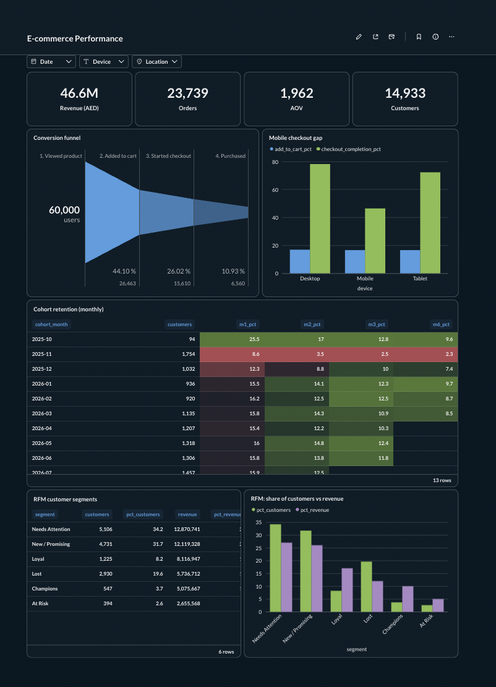
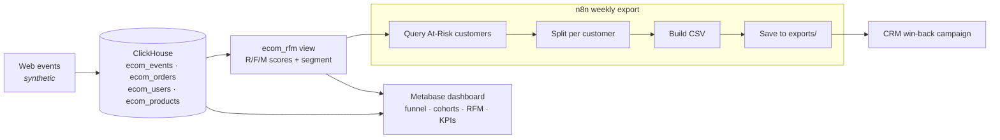

# E-commerce Analytics: Funnels, Cohorts & RFM on ClickHouse

Behavioural analytics for a GCC electronics store: **conversion funnels, cohort retention and RFM customer segmentation** on 1.2M events in **ClickHouse**, visualised in **Metabase**, with an **n8n** workflow that turns the analysis into a weekly win-back list for the CRM team.

**Result:** found a mobile checkout leak worth about **AED 7.5M/year (+16%)**, a promo cohort with **4.6× lower repeat rate**, and **394 high-value customers** drifting away. See the [insights memo](docs/insights-memo.md).

> Data is synthetic (60k visitors, 437k sessions, 1.23M events, 23.7k orders over 12 months), generated with realistic behaviour and planted issues to detect.



## Architecture



## What it demonstrates

| Area | Detail |
|---|---|
| **ClickHouse analytics functions** | `windowFunnel` for ordered 4-step funnels within 24h; `retention` for cohort matrices; `ntile` window functions for RFM scoring; `uniqExactIf` / `sumIf` conditional aggregates |
| **Data modelling** | Event table ordered by `(user_id, event_time)` for per-user sequence analysis, partitioned by month; reusable `ecom_rfm` view consumed by both BI and automation |
| **Analytical judgement** | Fixed thresholds instead of `ntile` for frequency (60% of customers have 1 order); incomplete cohort months shown as blank, not 0%; recency measured from the last data date, not "today" |
| **BI** | Metabase funnel, combo and heatmap visuals; field filters for date, device and location wired to dashboard filters |
| **Automation** | n8n turns the RFM segment into an actionable weekly CSV with a per-customer suggested action (VIP call vs. win-back code) |
| **Synthetic data generation** | 1.2M events generated in pure SQL with deterministic hashing (`cityHash64`), `ARRAY JOIN` session expansion and behavioural parameters |

## Key findings

| # | Finding | Recommendation | Impact |
|---|---|---|---|
| 1 | Mobile checkout completion **46%** vs desktop **78%**, with identical add-to-cart rates | Mobile checkout UX audit and A/B test | ~AED 7.5M/year (+16%) |
| 2 | White Friday promo customers: **8% repeat** vs 39%, **46% lower LTV** | Smaller discount plus a second-purchase incentive | ~AED 0.3M per campaign |
| 3 | **394 At-Risk** customers (avg AED 6.7k spend, ~200 days inactive) | Automated weekly win-back list (n8n) | ~AED 120k per campaign |

Full write-up: [docs/insights-memo.md](docs/insights-memo.md)

## Repo structure

```
├── docker-compose.yml           # n8n, ClickHouse 26.3 LTS, Metabase
├── .env.example                 # credentials template
├── sql/
│   ├── 01_ecom_schema_and_seed.sql   # tables + 12 months of synthetic behaviour
│   └── 02_ecom_rfm_view.sql          # RFM scoring + segments
├── metabase/questions/          # SQL behind each dashboard card + the export query
├── workflows/
│   └── weekly-at-risk-customers-export.json   # import into n8n
├── scripts/
│   ├── bootstrap.sh             # create users, schema, data, views
│   └── export-workflows.sh      # export n8n workflows without personal data
├── exports/                     # n8n writes weekly CSVs here (git-ignored)
└── docs/
    ├── insights-memo.md
    ├── operations.md
    └── screenshots/
```

## Run it locally

Requires Docker Desktop.

```bash
cp .env.example .env            # then set passwords
docker compose up -d            # n8n :5678 · Metabase :3000 · ClickHouse :8123
./scripts/bootstrap.sh          # users, schema, ~1.2M events (≈15 s), RFM view
```

1. **Metabase** (http://localhost:3000): add a ClickHouse database (host `clickhouse`, port `8123`, database `analytics`, user `METABASE_CH_USER`), then recreate the cards from `metabase/questions/`.
2. **n8n** (http://localhost:5678): import `workflows/weekly-at-risk-customers-export.json` and create a Basic Auth credential with `N8N_CH_USER` / `N8N_CH_PASSWORD`. CSVs appear in `./exports`.

## Notes
- ClickHouse is pinned to **26.3 LTS**: `latest` (26.9) breaks the JDBC driver bundled with Metabase 0.64 (`Invalid LZ4 magic byte`).
- ClickHouse resolves aliases before columns: `sum(revenue) AS revenue` followed by `avg(revenue)` fails with `ILLEGAL_AGGREGATION`, so aliases here never reuse a source column name.
- Companion project: **Marketing Analytics Pipeline** (Google Ads → ClickHouse → Metabase) runs on the same stack.
